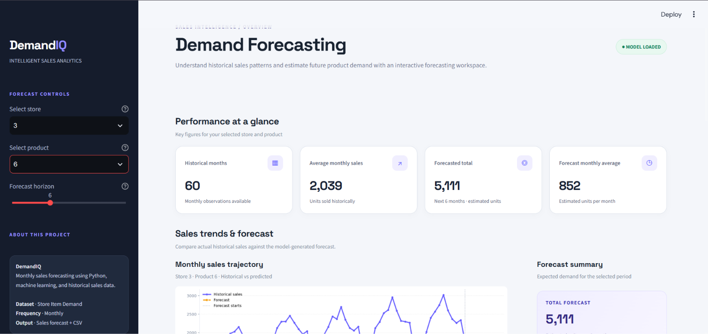
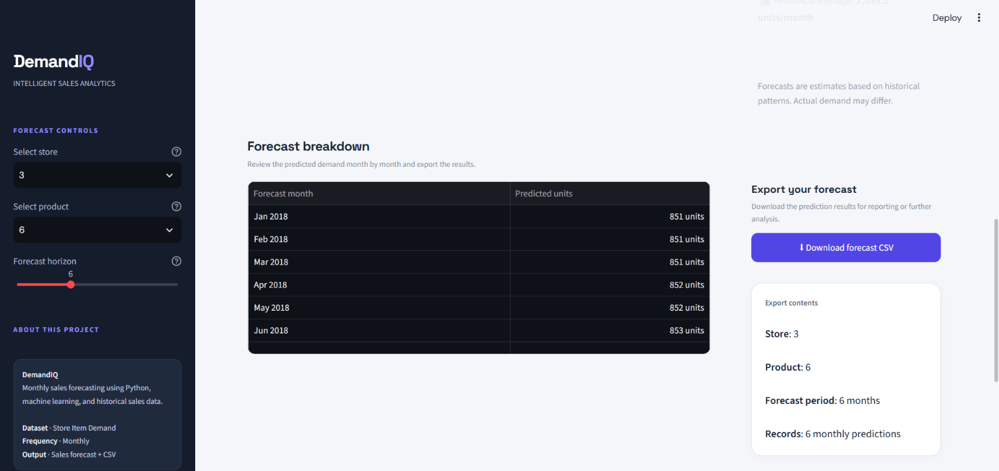
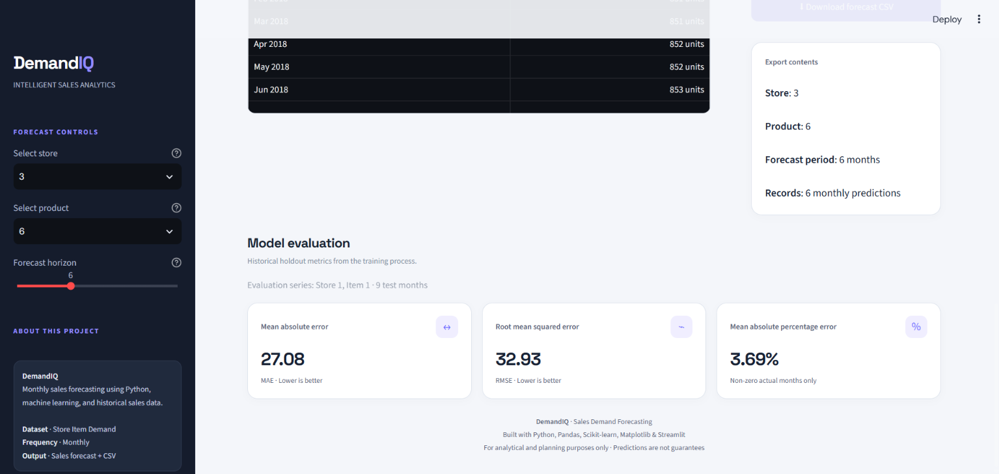

# DemandIQ — Sales Demand Forecasting

DemandIQ is a machine learning-based sales demand forecasting application built with Python, Pandas, Scikit-learn, and Streamlit. It aggregates daily retail sales into monthly demand, evaluates a forecasting model using a chronological holdout, and provides an interactive dashboard to estimate future monthly product sales.

## 📸 Project Screenshots

### 1. Dashboard Overview


### 2. Sales Forecast


### 3. Forecast Results


## ✨ Features

- Analyze historical sales trends by store and product.
- Aggregate daily retail sales into monthly totals.
- Forecast future monthly unit sales for up to 12 months.
- Evaluate model performance using MAE and RMSE.
- Calculate MAPE on non-zero actual sales values.
- Explore forecasts through an interactive Streamlit dashboard.
- Download forecast results as a CSV file.

## 🛠️ Tech Stack

- **Language:** Python
- **Data Processing:** Pandas, NumPy
- **Machine Learning:** Scikit-learn, Random Forest Regressor
- **Visualization:** Matplotlib
- **Dashboard:** Streamlit
- **Model Persistence:** Joblib

## 📂 Project Structure

```text
DemandIQ-Sales-Forecasting/
├── app.py
├── train.py
├── requirements.txt
├── README.md
├── .gitignore
├── models/
│   ├── model_info.json
│   └── sales_forecast_model.joblib
├── reports/
├── screenshots/
│   ├── dashboard-overview.png
│   ├── sales-forecast.png
│   └── forecast-results.png
└── src/
    ├── __init__.py
    └── forecasting.py
```

## 📊 Dataset

This project uses the [Store Item Demand Forecasting Challenge dataset on Kaggle](https://www.kaggle.com/competitions/demand-forecasting-kernels-only/data).

1. Download `train.csv` from Kaggle.
2. Create the folder `data/raw/` in the project directory if it does not exist.
3. Place the downloaded file at `data/raw/train.csv`.

The dataset is not included in this repository.

Expected columns: `date`, `store`, `item`, `sales`.

## ⚙️ Installation and Setup

### 1. Clone the repository

```bash
git clone https://github.com/bhaveshsalunke098/DemandIQ-Sales-Forecasting.git
cd DemandIQ-Sales-Forecasting
```

### 2. Create and activate a virtual environment

**Windows PowerShell:**

```powershell
python -m venv .venv
.\.venv\Scripts\Activate.ps1
```

**macOS/Linux:**

```bash
python3 -m venv .venv
source .venv/bin/activate
```

### 3. Install dependencies

```bash
python -m pip install --upgrade pip
pip install -r requirements.txt
```

### 4. Download the dataset

Follow the dataset instructions above and place `train.csv` at `data/raw/train.csv`.

### 5. Train the model

```bash
python train.py
```

This trains and evaluates the model and saves the trained model and evaluation information.

### 6. Launch the dashboard

```bash
python -m streamlit run app.py
```

Open the local URL displayed in your terminal to use the application.

## 🔍 Methodology

1. **Data preparation:** Convert dates and aggregate daily sales into monthly totals for each store-item series.
2. **Feature engineering:** Use calendar features, a time index, lagged sales, and trailing rolling averages.
3. **Model training:** Train a Random Forest regression model using historical sales features.
4. **Evaluation:** Use a chronological holdout to evaluate predictions with MAE and RMSE; calculate MAPE only for non-zero actual values.
5. **Forecasting:** Use available historical data to generate future monthly sales estimates and display the results in Streamlit.

## 📈 Evaluation

The training script records evaluation metrics in `models/model_info.json` and `reports/evaluation_metrics.csv`. Test predictions are saved to `reports/test_predictions.csv`.

MAE and RMSE measure prediction error; lower values generally indicate better predictions on the evaluated data. MAPE is calculated only for observations with non-zero actual sales.

**Scope of evaluation:** The current version trains on one store-item series. The reported metrics should not be interpreted as evidence of validated performance across every store and product.

## ⚠️ Limitations

- The current model is trained on one store-item series; broader evaluation is needed before business use.
- Promotions, holidays, stockouts, pricing changes, and other external factors are not fully captured.
- Forecasts are estimates and are not guaranteed future sales.
- Performance on one store-item series may not generalize to other products or stores.

## 🚀 Future Improvements

- Compare the Random Forest model with seasonal-naive and other forecasting approaches.
- Evaluate multiple store-item series using rolling-origin backtesting.
- Incorporate holiday, promotion, and pricing features.
- Add prediction intervals and model monitoring.
- Deploy the dashboard for online access.

## 👨‍💻 Author

**Bhavesh Salunke**

- **GitHub:** https://github.com/bhaveshsalunke098
- **LinkedIn:** https://linkedin.com/in/bhavesh-salunke-7a4163283
- **Portfolio:** https://techbhavesh.netlify.app

---

If you find this project useful, feel free to ⭐ the repository!
